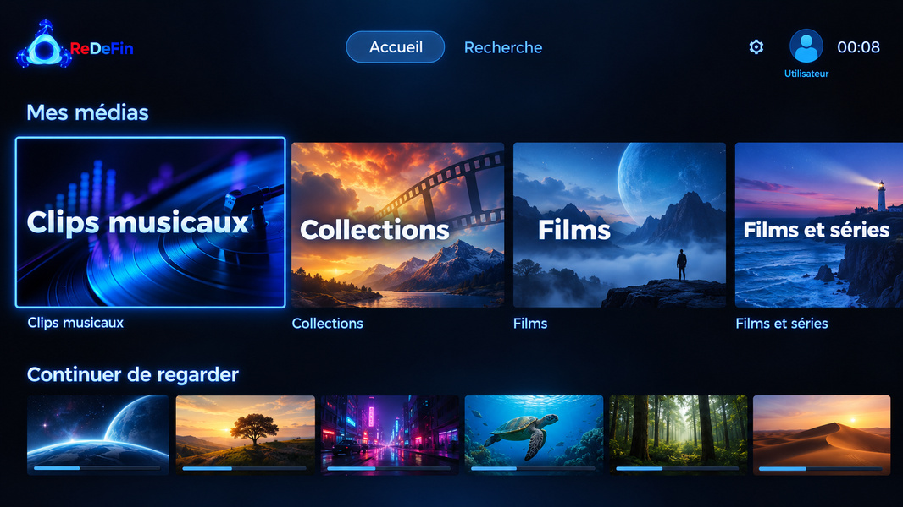
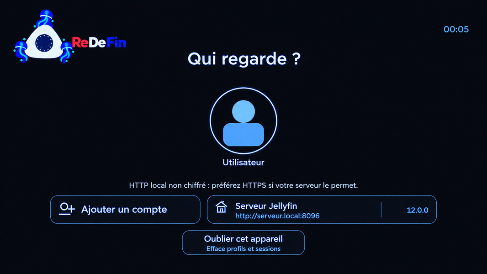
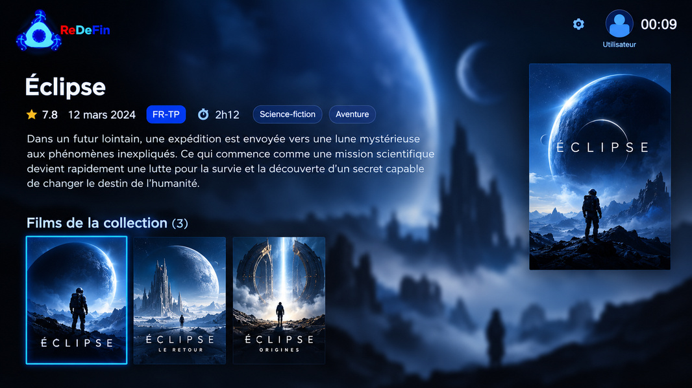

<!-- README ReDeFin : une vitrine construite à partir du logo et des captures authentiques du projet. -->

<h1>ReDeFin</h1>

<h3>Un client Jellyfin non officiel pour lire votre bibliothèque sur Freebox</h3>

ReDeFin est un client non officiel Jellyfin pensé spécialement pour les Freebox Player (Révolution / Devialet).

Son objectif : Profiter de votre bibliothèque comme sur une grande plateforme de streaming avec votre serveur, vos fichiers, votre Freebox.

  &nbsp;&nbsp;
  &nbsp;&nbsp;
  &nbsp;&nbsp;
  

  
  
  
  

<!-- Une capture authentique dès l'ouverture du dépôt. -->

01 / Accueil · Capture d'écran de l'application

<!-- Trois portes d'entrée : découvrir, signaler, proposer. -->

  <a href="#installation"> <strong>Voir la documentation</strong></a>&nbsp;&nbsp;
  <a href="https://github.com/laborantine/ReDeFin/issues/new?labels=bug"> <strong>Rapporter un bug</strong></a>&nbsp;&nbsp;
  <a href="https://github.com/laborantine/ReDeFin/issues/new?labels=enhancement"> <strong>Suggérer une nouvelle fonctionnalité</strong></a>

  <a href="#about-this-project">Le projet</a>&nbsp; · &nbsp;
  <a href="#usage">Usage</a>&nbsp; · &nbsp;
  <a href="#captures">Captures</a>&nbsp; · &nbsp;
  <a href="#prerequisites">Compatibilité</a>&nbsp; · &nbsp;
  <a href="#installation">Installation</a>&nbsp; · &nbsp;
  <a href="#contributing">Contribuer</a>

<strong>Sommaire complet</strong>

- [À propos de ce projet](#about-this-project)
- [Usage](#usage)
- [Roadmap](#roadmap)
- [L'application en images](#captures)
- [Prérequis](#prerequisites)
- [Introduction](#getting-started)
- [Installation](#installation)
- [Contributeurs](#contributing)
- [Fabriqué avec](#built-with)
- [Licence](#license)
- [Contact](#contact)
- [Remerciements](#acknowledgments)

---

## À propos de ce projet

ReDeFin est un client Jellyfin NON OFFICIEL codé en QML et JavaScript, compatible Freebox Revolution et Freebox Delta (Devialet).

L'objectif souhaité est de se rapprocher visuellement et fonctionnellement de ce que le client officiel Android TV est capable de faire.

##  Usage

Cette application vous permet de lire vos épisodes de séries et vos films de votre bibliothèque Jellyfin. Le support de la bibliothèque musicale et des chaines TV sont à l'étude.

_Pour plus d'exemples, Référez-vous à la [documentation officielle de Jellyfin](https://jellyfin.org/docs/)_

##  Roadmap

- [x] Support de la bibliothèque Séries, Films et Collections
- [x] Lecteur vidéo compatible DirectPlay/Remux/DirectStream/Transcodage
- [x] Support multi-profil

Voir [open issues](https://github.com/laborantine/ReDeFin/issues) pour un aperçu complet des nouvelles fonctionnalités (et des problèmes connus).

&nbsp;<a href="https://github.com/laborantine/ReDeFin/issues">Consulter les issues et les évolutions</a>

---

##  L'application en images

<table>
  <tr>
    <td align="center" valign="top" width="50%">
      
       <strong>02 / Profils</strong>
    </td>
    <td align="center" valign="top" width="50%">
      
       <strong>03 / Collection</strong>
    </td>
  </tr>
</table>

##  Prérequis

Vous devez disposer au moins de l'un des produits suivants pour bénéficier de cette application :

<table>
  <tr>
    <td width="50%" valign="top" align="center">
      <strong>Freebox Révolution</strong>  
      
    </td>
    <td width="50%" valign="top" align="center">
      <strong>Freebox Delta-Devialet</strong>  
      
    </td>
  </tr>
</table>

---

## Introduction

Le projet est actuellement en phase bêta fermé.

<table>
  <tr>
    <td width="50%" valign="top">
      <strong>Freebox Devialet</strong>
      
Disponibilité des places pour candidater en tant que beta-testeur sur la Freebox Devialet :

      
    </td>
    <td width="50%" valign="top">
      <strong>Freebox Revolution</strong>
      
Disponibilité des places pour candidater en tant que beta-testeur sur la Freebox Revolution :

      
    </td>
  </tr>
</table>

Pour candidater en tant que bêta-testeur, il faut vous munir de votre n° d'abonné Freebox (commençant la plupart du temps par fbxXXX) que vous retrouvez sur votre espace client Freebox. Une fois que vous avez cette information, veuillez envoyer un mail en précisant êgalement la Freebox que vous avez et envoyez le tout à : application.redefin@proton.me.

##  Installation

&nbsp;

Une fois votre mail envoyé à application.redefin@proton.me pour candidater en qualité de bêta-testeur, vous aurez une réponse vous confirmant la prise en compte de votre mail et la déclaration de votre n° d'abonné (identifiant Freebox) dans la liste des bêta-testeurs.

Vous pourrez alors vous rendre dans le Free Store sur votre Freebox Player afin de télécharger ReDeFin.

> [!CAUTION]
> **Utilisateurs Freebox Devialet**
>
> Pour télécharger ReDeFin depuis le Free Store, votre Freebox Devialet doit être rattachée à un abonnement Free permettant l'accès au Free Store.
>
> Si vous possédez une Freebox Devialet sans abonnement Free associé, merci de me contacter. Une méthode de test alternative pourrait vous permettre d'exécuter ReDeFin autrement.

---

##  Contributeurs

Les contributions font de la communauté open source un lieu exceptionnel pour apprendre, s'inspirer et créer. Toute contribution est **gratuitement appréciée**.

Si vous avez une suggestion pour améliorer ce projet, n'hésitez pas à forker le dépôt et à créer une pull request. Vous pouvez également ouvrir une issue avec l'étiquette « enhancement ».

Pensez à mettre une étoile au projet ! Merci encore ;)

<table>
  <tr>
    <td align="center" width="33%"><a href="https://github.com/laborantine/ReDeFin/fork"> <strong>Forker le dépôt</strong></a></td>
    <td align="center" width="33%"><a href="https://github.com/laborantine/ReDeFin/pulls"> <strong>Pull requests</strong></a></td>
    <td align="center" width="34%"><a href="https://github.com/laborantine/ReDeFin/stargazers"> <strong>Mettre une étoile</strong></a></td>
  </tr>
</table>

### Top contributors:

---

## Fabriqué avec

  
  
  
  
  
  

Ce projet a été intégralement fabriqué à partir de ChatGPT depuis 2024. Il a été fabriqué à partir des modèles de langages suivants :

<strong>Travaux préliminaires (2024 - mars 2025) :</strong>

- GPT-3.5
- GPT-4
- GPT-4o

<strong>Travaux principaux (avril 2025 - maintenant) :</strong>

- GPT-4.5
- GPT-5
- GPT-5.1
- GPT-5.2
- GPT-5.4
- GPT-5.5
- GPT-5.6 Sol
- GPT 6.1 Sol

---

##  Licence

Distribuée sous la licence GPL 3.0. Regardez le fichier [`LICENSE`](https://github.com/laborantine/ReDeFin/blob/beta/LICENSE) pour plus d'informations.

##  Contact

  
  

Laborantine - (https://github.com/laborantine/ReDeFin/issues) - application.redefin@proton.me

Lien officiel du projet : [https://github.com/laborantine/ReDeFin](https://github.com/laborantine/ReDeFin)

## Remerciements

Un grand merci à :

- L'équipe de Free
- L'équipe des beta-testeurs
- OpenAI

  
  &nbsp;&nbsp;
  

<a href="#readme-top">↑ Retour en haut de page</a>

<!-- Le nom des fichiers de captures correspond aux originaux préparés le 15 octobre 2026. -->
<!-- Les logos externes servent à identifier des technologies, sans suggérer de partenariat officiel. -->
